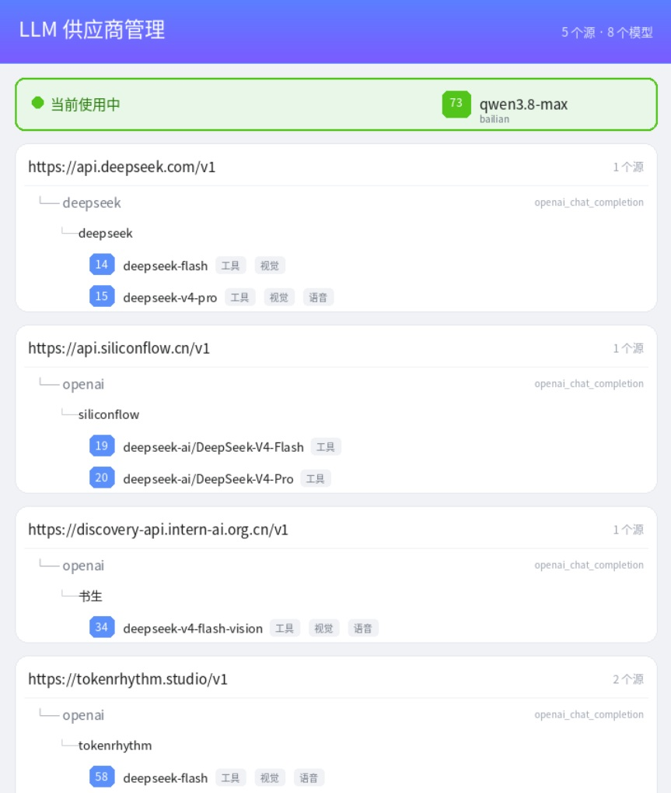

# astrbot_plugin_llm_manager · LLM 供应商管理

把全部模型按 "地址→分组（key）→模型" 三级归拢，通过指令实现图形化查看模型列表（支持名称查找）、全局切换、单个或多个模型测速、查看 token 消耗，全程指令化不用进后台

把 AstrBot 的供应商配置收敛为**一个虚拟 Provider**，按三级结构统一管理：



```
第一级  API Base URL
第二级  分组（key）
第三级  模型 ID（带全局序号 [1][2][3]…，切换用序号即可）
```

**实现功能**：

1.通过指令将模型列表排序并渲染成图片直观展示，支持模型名称模糊查找

2.通过指令快捷切换全局/当前会话模型

3.通过指令测试快捷当前模型延迟，可自由指定多个

4.通过指令显示各模型token消耗排行

5.主模型不可用时按备选池自动降级，支持冷却跳过与会话粘滞

---

## 安装配置

1. 安装本插件。
2. 启动后插件会自动注册一个新提供商类型 **LLM Manager**。
3. 在 QQ 里发 **`/llmm import`**，从系统配置一键导入已有供应商和模型。导入时会自动读取原默认提供商（旧版 `default_provider_id`，AstrBot 4.29+ 的 `agent_runner.config.model.provider_id`）并设为插件全局默认，确保安装后默认模型不变。
4. 打开 WebUI → **服务提供商**：
   - 新增提供商：类型选 **LLM Manager**，`id` 随意（如 `llm_manager`），`key` 留空，保存。
   - 在该提供商的「模型」区域点「自定义模型」，添加一个占位模型，模型名填 **`main`**（**不要填真实模型名**），保存。
5. 左侧菜单 **配置** → 找到 **默认聊天模型** → 选择 `llm_manager / main` → 保存配置。此后所有对话请求都先经过 LLM Manager 路由。

> ⚠️ **关键**：LLM Manager 实例的 `model` 字段必须是占位符（如 `main`），不能是你目录里的真实模型名。否则 AstrBot 每次请求都会固定用那个模型，`/llmm use` 切换不会生效。

---

## 常用指令

```
/llmm import          # 首次安装插件时使用，从系统配置导入所有供应商
/llmm resync          # 后台手动删改模型供应商配置后，用此命令刷新模型列表

/llmm list            # 查看所有模型 （渲染成卡片图片展示，需安装pillow）
/llmm search deepseek # 按模型名模糊搜索，返回匹配模型及原有序号
/llmm search gpt 6    # 多个关键词需全部命中，忽略大小写
/llmm use 3           # 切换到序号 3 的模型 （全局生效）

/llmm test            # 测试当前模型延迟
/llmm test 4          # 测试4号模型延迟
/llmm test 3 5 8      # 批量测试3，5，8号模型延迟(最多支持10个)

/llmm stats          # Token消耗统计 默认最近 7 天
/llmm stats 1d       # 最近 1 天
/llmm stats 7d       # 最近 7 天
/llmm stats 30d      # 最近 30 天
/llmm stats all      # 全部历史（受 30 天保留期限制）

/llmm fallback               # 查看故障转移开关、模式与备选池
/llmm fallback add 3 5       # 把目录序号 3、5 加入备选池（也可写 实例id/模型id）
/llmm fallback on            # 开启故障转移（默认关闭）
```

注意：若切换模型并未生效（日志中会显示请求实际路由到那个模型），将供应商llm_manager**删掉重新配置即可。配置方法如下：

- 打开 WebUI → **服务提供商**：
  - 新增提供商：类型选 **LLM Manager（注意不是llm_manager）**，`id` 随意（默认 `llm_manager`），`key` 留空，保存。
  - 在该提供商的「模型」区域点「自定义模型」，添加一个占位模型，模型名填 **`main`**（**不要填真实模型名**），保存。
- 左侧菜单 **配置** → 找到 **默认聊天模型** → 选择 `llm_manager / main` → 保存配置。此后所有对话请求都先经过 LLM Manager 路由。

---

## 指令详解

> 所有 `/llmm` 指令默认仅管理员可用。关闭 `admin_only` 后，查看、搜索、切换、测速、统计和帮助对群成员开放；添加、删除、导入、重建等写操作始终仅管理员可用。

---

### 📋 `/llmm list` — 查看所有模型

按三级结构展示：API Base URL → 实例 → 模型。每个模型前有全局序号，切换时用序号即可。

**参数：**

| 参数    | 说明                   |
| ----- | -------------------- |
| （无）   | 默认渲染成卡片图片            |
| `-t`  | 纯文本模式（不发图片）          |
| `关键词` | 过滤包含关键词的行（仅纯文本模式下有效） |

**例子：**

```
/llmm list                  # 卡片图片查看
/llmm list -t               # 纯文本查看
/llmm list -t deepseek      # 纯文本过滤，只看含 deepseek 的行
/llmm list -t gemini        # 纯文本过滤，只看含 gemini 的行
```

图片卡片顶部会显示**当前正在使用的模型和序号**，每个模型带序号徽章和能力标签（工具/视觉/语音），停用的模型会标注。

---

### 🔎 `/llmm search` — 按模型名模糊搜索

从已导入或手动添加的模型目录中筛选模型，返回与 `/llmm list` 相同样式的卡片图片，只展示匹配模型及其所属站点、分组。按模型名做子串匹配，忽略大小写；空格分隔的多个关键词需全部出现在模型名中，顺序不限。图片渲染失败时回退为筛选后的纯文本列表。

```
/llmm search deepseek       # 查找所有模型名包含 deepseek 的条目
/llmm search GPT            # 可匹配 gpt、GPT 等大小写形式
/llmm search qwen 72b       # 模型名需同时包含 qwen 和 72b
/llmm search Qwen/Qwen2.5   # 支持带斜杠的模型名
```

结果保留 `/llmm list` 的全局序号，并显示所属站点、分组、能力标签和当前使用状态。同名模型位于不同分组时分别列出；停用条目也会列出并标记「停用」。可以用 `/llmm use <序号>` 切换到对应模型。

不带关键词时显示用法，没有匹配结果时给出提示。搜索遵循插件的 `admin_only` 权限配置。

---

### 🔄 `/llmm use` — 切换模型

切换当前使用的模型。支持按序号、模型 ID、实例 ID 切换。

**参数：**

| 参数       | 说明                         |
| -------- | -------------------------- |
| `<序号>`   | 按 `/llmm list` 里的序号切换（最常用） |
| `<模型id>` | 按模型名称切换，如 `deepseek-chat`  |
| `<实例id>` | 按实例 ID 切换，切到该实例的默认模型       |
| `-c`     | 仅当前会话切换（不影响全局和其他会话）        |
| `global` | 清除当前会话的独立切换，回到全局默认         |
| （无参数）    | 查看当前生效的模型和切换状态             |

**例子：**

```
/llmm use 3                  # 全局切换到序号 3 的模型
/llmm use deepseek-reasoner  # 全局切换到模型 deepseek-reasoner
/llmm use deepseek_推理      # 全局切换到实例 deepseek_推理 的默认模型
/llmm use 4 -c               # 仅当前会话切换到序号 4（其他会话不受影响）
/llmm use global             # 清除当前会话切换，回到全局默认
/llmm use                    # 查看当前生效的模型、全局默认、会话切换状态
```

---

### ⭐ `/llmm default` — 设置全局默认模型

设置全局默认模型。所有没有独立会话切换的对话都会用这个模型。

**参数：**

| 参数       | 说明                       |
| -------- | ------------------------ |
| `<序号>`   | 按序号设为全局默认                |
| `<模型id>` | 按模型名称设为全局默认              |
| `<实例id>` | 按实例 ID 设为全局默认（用该实例的默认模型） |
| （无参数）    | 查看当前全局默认                 |

**例子：**

```
/llmm default 3              # 把序号 3 的模型设为全局默认
/llmm default                # 查看当前全局默认
```

> `/llmm use` 不带 `-c` 时会写入全局默认并持久化，`/llmm default` 效果相同、语义更明确。只想影响当前会话时务必加 `-c`。

---

### 📥 `/llmm import` — 从系统配置导入

从 AstrBot 的 `cmd_config.json` 导入已有的供应商和模型。这是安装后的第一步。

**参数：** 无

**例子：**

```
/llmm import
```

导入时会：

- 自动读取所有 `provider_sources`（API Base URL + key）和模型
- 按三级结构导入插件管理
- **自动读取你原来的默认模型并设为插件全局默认**，确保安装插件后默认模型不变
- dashscope 等 agent_runner 类型会自动跳过

> ⚠️ 必须在你把默认聊天提供商改成 LLM Manager **之前**执行（旧版为 `default_provider_id`，AstrBot 4.29+ 在 agent runner 的模型配置中），否则原来的默认模型值已被覆盖，无法自动保留。

---

### 🔄 `/llmm resync` — 从系统配置完全重建

如果你**手动在 AstrBot WebUI 删除或修改了供应商**，插件的配置不会自动同步，`/llmm list` 还会显示旧数据。此时用这个指令完全重建。

**参数：** 无

**例子：**

```
/llmm resync
```

重建时会：

- 先清空插件现有配置，再从 `cmd_config.json` 重新导入
- 保留你设置的全局默认模型（如果目标仍存在）
- 清理无效的会话切换

> 与 `/llmm import` 的区别：`import` 是增量导入（已有的不重复添加），`resync` 是完全重建（先清空再导入）。手动删除供应商后用 `resync`。

---

### ➕ `/llmm add` — 手动添加后端（一级源）

添加一个新的 API Base URL 和 key。适用于不在系统配置里的新供应商。

**参数：**

| 参数           | 说明                                     |
| ------------ | -------------------------------------- |
| `<站名>`       | 给这个后端起个名字，如 `DeepSeek`、`硅基流动`          |
| `<base_url>` | API 地址，如 `https://api.deepseek.com/v1` |
| `<key>`      | API Key                                |
| `[类型]`       | 可选，提供商类型，默认 `openai_chat_completion`   |

**例子：**

```
/llmm add DeepSeek https://api.deepseek.com/v1 sk-xxxx
/llmm add 硅基流动 https://api.siliconflow.cn/v1 sk-yyyy
/llmm add Claude https://api.anthropic.com sk-zzzz openai_chat_completion
```

添加后需要用 `/llmm group add` 建分组，再用 `/llmm model add` 挂模型。

---

### 👥 `/llmm group` — 分组实例管理

管理二级实例（分组）。每个实例属于一个一级源，实例 ID 自动生成为 `站名_分组名`。

**子命令：**

| 子命令       | 说明              |
| --------- | --------------- |
| `add`     | 新增分组实例          |
| `rm`      | 删除分组实例（含其下所有模型） |
| `enable`  | 启用分组实例          |
| `disable` | 停用分组实例（路由时自动跳过） |

**`/llmm group add` 参数：**

| 参数        | 说明                    |
| --------- | --------------------- |
| `<站名>`    | 所属一级源的站名              |
| `<分组名>`   | 分组名称，如 `通用`、`推理`、`高速` |
| `[模型...]` | 可选，创建时直接挂载的模型 ID      |

**例子：**

```
/llmm group add DeepSeek 通用 deepseek-chat deepseek-v3     # 建分组并挂模型
/llmm group add DeepSeek 推理                                 # 建空分组
/llmm group rm deepseek_推理                                  # 删除实例
/llmm group enable deepseek_通用                              # 启用实例
/llmm group disable deepseek_通用                             # 停用实例
```

---

### 🧠 `/llmm model` — 模型挂载管理

管理三级模型。在实例上挂载或移除模型。

**子命令：**

| 子命令   | 说明      |
| ----- | ------- |
| `add` | 给实例挂载模型 |
| `rm`  | 从实例移除模型 |

**参数：**

| 参数          | 说明                           |
| ----------- | ---------------------------- |
| `<实例id>`    | 实例 ID，如 `deepseek_通用`        |
| `<模型id>...` | 一个或多个模型 ID，如 `deepseek-chat` |

**例子：**

```
/llmm model add deepseek_通用 deepseek-chat deepseek-v3      # 挂载多个模型
/llmm model add deepseek_推理 deepseek-r1-0528               # 挂载单个模型
/llmm model rm deepseek_通用 deepseek-v3                      # 移除模型
```

---

### 🗑️ `/llmm rm` — 统一删除

删除一级源、二级实例或三级模型。

**子命令：**

| 子命令        | 说明                |
| ---------- | ----------------- |
| `source`   | 删除一级源（含其下所有分组和模型） |
| `instance` | 删除二级实例（含其下所有模型）   |
| `model`    | 删除三级模型            |

**例子：**

```
/llmm rm source DeepSeek              # 删除一级源 DeepSeek（含所有分组和模型）
/llmm rm instance deepseek_推理       # 删除实例 deepseek_推理
/llmm rm model deepseek_通用 deepseek-v3   # 从实例 deepseek_通用 移除模型 deepseek-v3
/llmm rm                              # 查看删除用法
```

> 删除后立即生效，用 `/llmm list` 查看最新配置。

---

### ✅ `/llmm enable` / `/llmm disable` — 启停实例

快速启用或停用一个实例。停用的实例在路由时会被自动跳过。

**参数：**

| 参数       | 说明                    |
| -------- | --------------------- |
| `<实例id>` | 实例 ID，如 `deepseek_通用` |

**例子：**

```
/llmm enable deepseek_通用       # 启用实例
/llmm disable deepseek_通用      # 停用实例（路由自动跳过）
```

> 也可以用 `/llmm group enable` 和 `/llmm group disable`，效果相同。

---

### 🧪 `/llmm test` — 连通性与时延测试

测试模型的连通性和响应延迟。支持批量测试多个模型。

**参数：**

| 参数          | 说明                           |
| ----------- | ---------------------------- |
| （无）         | 测试**当前正在使用**的模型              |
| `<序号>...`   | 测试一个或多个指定序号的模型（空格分隔，最多 10 个） |
| `<模型id>...` | 按模型 ID 测试                    |
| `<实例id>...` | 按实例 ID 测试（测该实例的默认模型）         |

**例子：**

```
/llmm test                  # 测试当前正在使用的模型
/llmm test 3                # 测试序号 3 的模型
/llmm test 3 5 7            # 批量测试序号 3、5、7 的模型（并行）
/llmm test 30 31 36         # 批量测试多个模型
/llmm test deepseek-chat    # 按模型 ID 测试
```

批量测试时会并行发起请求，结果按序号排列显示，每行标注 ✅/❌ + 延迟或错误信息，末尾显示成功数/总数。

---

### 🛟 `/llmm fallback` — 备选池与故障转移

主模型请求失败时，按备选池顺序自动尝试后面的模型，避免一次超时或限流就让整轮对话失败。默认**关闭**，需要手动开启。

**参数：**

| 参数                          | 说明                                  |
| --------------------------- | ----------------------------------- |
| （无）/ `list` / `status`      | 查看开关、模式、主模型、尝试上限、冷却与备选池状态           |
| `add <目标...>`               | 追加备选：目录序号、`实例id`、`实例id/模型`、模型 ID 均可 |
| `rm <池序号...>`               | 按**池序号**删除，支持 `2`、`1 3`、`2-4`、`1,3` |
| `move <池序号> <新位置>`          | 调整优先级，如 `move 3 1` 把第 3 条提到最前       |
| `clear confirm`             | 清空备选池并自动关闭（需带 `confirm` 确认）         |
| `on` / `off`                | 开启 / 关闭（关闭时保留备选池）                   |
| `mode transient` / `sticky` | 切换模式，默认 `transient`                 |
| `max <2-5>`                 | 总尝试次数（含主模型），默认 3                    |
| `cooldown <0-3600>`         | 失败后的冷却秒数，默认 120；`0` 表示关闭冷却          |
| `check`                     | 静态校验备选池（实例/模型是否存在、能力是否兼容），不调用模型     |

**例子：**

```
/llmm fallback                          # 查看当前配置
/llmm fallback add 3 5 B_通用/n1        # 按目录序号和 实例/模型 追加备选
/llmm fallback move 3 1                 # 把池中第 3 条提到最前
/llmm fallback rm 2-4                   # 删除池中第 2 到 4 条
/llmm fallback mode sticky              # 降级成功后本会话粘滞，主模型恢复后自动回退
/llmm fallback max 4                    # 最多尝试 4 个模型（含主模型）
/llmm fallback cooldown 300             # 失败模型冷却 5 分钟
/llmm fallback on                       # 开启
/llmm fallback clear confirm            # 清空并关闭
```

**两种模式：**

- `transient`（临时降级）：每轮请求都会先尝试主模型，失败后才按备选池降级；不改变全局默认和会话选择。主模型恢复后立即回到主模型。
- `sticky`（会话粘滞）：降级成功后，把可用模型写为**当前会话**的临时选择，主模型冷却期间该会话直接走它；主模型冷却结束且恢复后会自动撤销并回到主模型。其他会话和全局默认不受影响，也可用 `/llmm use global` 立即恢复。

**哪些错误会触发降级：**

| 情况                                 | 行为               |
| ---------------------------------- | ---------------- |
| 401/403/402（鉴权、余额）、429、408、网络中断/超时 | 冷却整个源，换源         |
| 5xx、404、模型不存在/已下线                  | 冷却该模型，换模型        |
| 400/413/422、上下文超长、内容策略拦截           | 不重试，直接报错（换模型也没用） |

**冷却与跳过：** 失败的备选模型（或整个源）在冷却期内会被自动跳过，不再浪费尝试次数；主模型每轮仍会先探测一次，确保恢复后立刻回到主模型，不会被残留冷却长期挡在备选上。如果所有候选都在冷却，会放行一次主模型做兜底探测。冷却只存在内存中，重启插件即清空。

**流式输出限制：** 流式请求只在**首个可见内容到达前**允许降级；一旦已经输出文字，再失败就只能报错，避免重复输出。空字符串片段不算可见内容。

**注意事项：**

- 备选池只会在开关开启时参与路由。主模型正常时不会额外产生请求。
- 备选模型必须支持本次请求需要的能力（图片/音频/工具调用）；不支持的会被跳过，不会把图片硬塞给纯文本模型。
- 客户端 SDK 自身的重试可能吞掉部分错误，此时插件看不到失败，自然不会触发降级。
- 查看跟随 `admin_only`；`add`/`rm`/`move`/`clear`/`on`/`off`/`mode`/`max`/`cooldown` 始终仅管理员可用。

---

### ❓ `/llmm help` — 查看帮助

查看所有指令的简要说明。

**参数：** 无

**例子：**

```
/llmm help
```

---

## 指令总表

| 指令                                     | 说明                 | 常用度 |
| -------------------------------------- | ------------------ | --- |
| `/llmm list [-t] [关键词]`                | 查看所有模型（三级结构，带序号）   | ⭐⭐⭐ |
| `/llmm use <目标> [-c]`                  | 切换模型（序号/模型ID/实例ID） | ⭐⭐⭐ |
| `/llmm default <目标>`                   | 设置全局默认模型           | ⭐⭐  |
| `/llmm import`                         | 从系统配置导入供应商         | ⭐⭐⭐ |
| `/llmm resync`                         | 从系统配置完全重建          | ⭐⭐  |
| `/llmm add <站名> <url> <key>`           | 添加一级源              | ⭐   |
| `/llmm group add <站名> <分组名> [模型...]`   | 建分组实例              | ⭐   |
| `/llmm group rm/enable/disable <实例id>` | 管理实例               | ⭐   |
| `/llmm model add/rm <实例id> <模型id>...`  | 挂载/移除模型            | ⭐   |
| `/llmm rm source/instance/model <目标>`  | 统一删除               | ⭐   |
| `/llmm enable/disable <实例id>`          | 启停实例               | ⭐   |
| `/llmm test [目标...]`                   | 连通性与时延测试（支持批量）     | ⭐⭐  |
| `/llmm fallback [子命令]`                 | 备选池与故障转移配置         | ⭐⭐  |
| `/llmm help`                           | 查看帮助               | ⭐   |

---

## 路由规则（优先级从高到低）

1. **请求显式指定的模型**（命中目录时）
2. **会话级切换**（`/llmm use -c`，按 unified_msg_origin 区分会话）
3. **全局默认**（`/llmm default`）
4. **第一个启用的模型**（兜底）

**能力适配**：路由时若目标模型不支持图片 / 音频 / 工具调用，会自动降级（忽略对应输入并记录日志），不会把不支持的能力硬塞给模型。

**故障转移**：以上规则选出主模型后，若请求因可重试错误失败，且已开启 `/llmm fallback`，则按备选池顺序继续尝试，直到成功或达到尝试上限。详见上文 `/llmm fallback`。

---

## 常见问题

**Q: 切换模型后聊天还是用原来的模型？**
A: 检查 WebUI 中 LLM Manager 实例的 `model` 字段是否为占位符（如 `main`），不能填真实模型名。同时确认默认聊天提供商已设为 LLM Manager 实例（旧版为 `default_provider_id`，AstrBot 4.29+ 在 agent runner 的模型配置中）。

**Q: 手动在 WebUI 删除了供应商，`/llmm list` 还显示？**
A: 插件配置和 AstrBot 配置是独立的。执行 `/llmm resync` 从系统配置完全重建即可。

**Q: 想让群成员也能用切换指令？**
A: 在 WebUI 插件配置中关闭 `admin_only`，查看、切换、测速、统计等日常指令会对所有人开放；写操作（添加/删除/导入/重建）仍仅管理员可用。

**Q: 安装插件后默认模型变了？**
A: 确保先执行 `/llmm import`（此时原默认模型还在），再把默认聊天提供商改成 LLM Manager。导入时会自动保留原默认模型。

**Q: 配置了备选池，主模型失败却没有降级？**
A: 依次检查：`/llmm fallback` 是否显示「开启」；失败是否属于可重试类型（400、上下文超长、内容拦截不会重试）；备选是否因实例停用、模型删除或能力不匹配被跳过；流式请求是否已经输出了内容。可用 `/llmm fallback check` 做静态排查。

**Q: 降级后一直用备用模型，测试主模型却是通的？**
A: 先执行 `/llmm fallback` 查看「主模型冷却」和「当前会话」两行。`sticky` 模式在主模型冷却期间会维持会话粘滞；冷却结束后会自动撤销。若是升级前留下的旧粘滞，执行一次 `/llmm use global` 即可。`transient` 模式每轮都会先探测主模型。

**Q: 冷却中的模型什么时候恢复？**
A: 冷却到期自动恢复，默认 120 秒；重启插件会立即清空全部冷却。`/llmm fallback cooldown 0` 可关闭冷却机制。

---

## 数据与配置

- **配置仓库**：`data/plugin_data/astrbot_plugin_llm_manager/backends.json`（三级结构 + 默认与会话切换 + 故障转移配置）
- **统计仓库**：同目录 `stats.json`，降级成功的请求会额外记录 `fallback_from`（原主模型），`/llmm stats` 会显示「其中降级响应」次数
- **插件配置**：WebUI 插件配置中 `admin_only`（默认开启）控制日常指令是否仅管理员可用；写操作始终仅管理员可用
- **路由日志**：`verbose_routing_log`（默认开启）控制每条请求的 INFO 路由诊断与后端模型设置日志；关闭后降为 DEBUG，可减少日志量
- **自动备份**：`/llmm resync` 前会生成 `backends.json.bak`；配置损坏时会重命名为 `backends.json.corrupt-<时间戳>` 保留现场
- **冷却状态**：只保存在内存中，不写入磁盘，重启即清空
- 所有 API Key 只存在插件自己的 backends.json 中，不写入 AstrBot 配置

---

## 兼容性

- 面向 AstrBot 4.23+（在 4.26.x 上开发验证）
- 委托层复用 AstrBot 内置 Provider（OpenAI 兼容 / Anthropic / Gemini / 小米等），新增类型无需改本插件
- Pillow 用于 `/llmm list` / `/llmm search` 图片渲染；缺失时自动回退纯文本，不影响其他指令。启动时不再自动修改 Python 环境。
